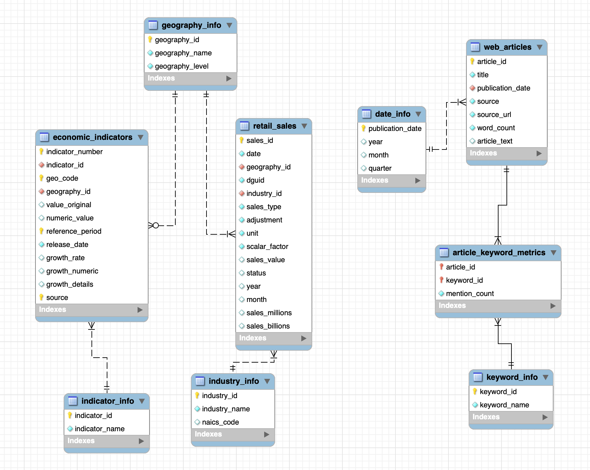

# Canadian Retail Market Intelligence
### BSMM 8730 - Data Acquisition and Management | Group 2
University of Windsor

## Project overview

The project brings together Statistics Canada retail sales and economic indicators with Competition Bureau Canada articles to support historical retail market analysis. Python prepares the sources, MySQL stores the records, and SQL produces analytical outputs. Power BI dashboards are **planned**; the submitted Design document includes proposed layouts rather than a finished application.

## Project documentation

- [User Requirements and Analysis](docs/submissions/user_requirements_and_analysis.pdf)
- [Project Documentation: Design](docs/submissions/project_design.pdf)
- [Schema, keys, data dictionary and design boundaries](docs/database_design.md)
- [Requirements-to-implementation mapping](docs/requirements_traceability.md)
- [Validation record](docs/validation.md)
- [AI assistance record](docs/ai_assistance.md)

## ERD 1.0



The schema contains **nine base tables and seven foreign keys**, plus one derived view. The view is omitted from the ERD. Article keyword counts use a junction table; publication date is the primary key of `date_info` and a foreign key in `web_articles`.

| Base table | Current snapshot rows |
|---|---:|
| retail_sales | 69,115 |
| economic_indicators | 38 |
| web_articles | 7 |
| geography_info | 23 |
| industry_info | 30 |
| indicator_info | 5 |
| date_info | 6 |
| keyword_info | 5 |
| article_keyword_metrics | 35 |

Counts of reference and junction rows are different from source-record counts. `article_keyword_frequencies` provides 35 derived rows, including zero counts, without storing duplicate frequency columns.

## Rebuild from the tracked CSV snapshot

Use Python 3.9+ and MySQL 8.0.16+ (tested on MySQL 8.3). Run commands from the repository root. Existing notebooks remain the original preparation record; rebuilding the current snapshot does not require re-scraping websites.

**Use a new database. These files create the agreed schema from scratch; they do not migrate an existing Workbench database.** Surrogate geography/industry/indicator IDs are assigned deterministically for this rebuild and need not equal IDs in an older local database. Do not copy these IDs between database instances.

```bash
python3 -m venv .venv
source .venv/bin/activate
python -m pip install -r requirements.txt
# Replace YOUR_USER with your own MySQL account; passwords are prompted.
mysql -u YOUR_USER -p -e "CREATE DATABASE data_acq_project_rebuild CHARACTER SET utf8mb4 COLLATE utf8mb4_unicode_ci"
mysql -u YOUR_USER -p data_acq_project_rebuild < sql/data_acq_project_schema.sql
python scripts/import_data.py --database data_acq_project_rebuild --user YOUR_USER
mysql -u YOUR_USER -p data_acq_project_rebuild < sql/validation.sql
python scripts/import_data.py --database data_acq_project_rebuild --user YOUR_USER --validate-only
```

Optional `--host`, `--port`, and `--socket` arguments select your connection. Passwords are prompted or read from `MYSQL_PASSWORD`; never commit credentials. The import uses a single transaction, loads parents before children, preserves empty economic levels as SQL NULL, and reconciles every imported row before committing. A populated target is accepted only if it exactly matches the prepared snapshot; mismatches stop without overwriting it. To use a changed snapshot, create another rebuild database.

```bash
# Offline source validation; no database connection:
python scripts/import_data.py --database unused --check-csv
python -m unittest discover -s tests -v
# Read-only query examples (can also be opened in Workbench):
mysql -u YOUR_USER -p data_acq_project_rebuild < sql/analysis_queries.sql
```

`sql/import_data.sql` is retained as a pointer to the Python importer. The old direct CSV-to-three-wide-tables LOAD DATA statements no longer apply. The historical SQL File 6 is an execution log, not a setup script, and is intentionally not published as the canonical schema.

## Sources and analytical limits

| Input | Tracked data | Coverage |
|---|---|---|
| [StatCan Table 20-10-0056-01](https://www150.statcan.gc.ca/t1/tbl1/en/tv.action?pid=2010005601) | structured_data/retail_sales_clean.csv | 69,115 observations; Jan 2017-Jun 2026 |
| Statistics Canada economic-indicator JSON snapshot | semi_structured_data/ind-econ_(semi-structured data).json and economic_indicators_clean.csv | 38 selected observations, five indicator types; limited reporting periods |
| Competition Bureau Canada public articles | unstructured_data/web_articles_clean.csv | Seven articles, Oct 2022-Sep 2026; individual URLs retained in source_url |

- Filter a single industry, sales type, adjustment and geographic level before comparing totals. National, provincial and metropolitan records overlap; industry aggregates also overlap.
- E-commerce data in this snapshot is national. Do not imply provincial e-commerce coverage.
- Economic levels use different units. Retain reporting period, release date, growth basis and the difference between percentages and percentage points. CPI and GDP source levels are missing; their growth values remain available.
- The economic snapshot is not a historical time series. Monthly economic periods do not overlap the available retail months; any quarterly comparison needs explicit period and measurement alignment. No automatic record-level join is implied.
- Keyword metrics describe the collected article text, not measured competition intensity or sentiment. The original scraper can repeat some webpage sections and extracts dates heuristically; this update preserves that evidence, rather than claiming it has been re-audited.
- Geographic parent relationships and finer CMA/CMA-part labels remain deferred, as agreed. `geography_level` retains the current ERD 1.0 categories.

## Repository structure

- `structured_data/`, `semi_structured_data/`, `unstructured_data/`: original datasets and exploratory notebooks
- `sql/`: current schema, validation and analysis queries
- `scripts/`: repeatable snapshot import and source reconciliation
- `tests/`: checks for missing values, duplicate business keys and metric consistency
- `docs/`: supplied project submissions, ERD, schema reference and implementation status

## Current progress

| Workstream | Status |
|---|---|
| Initial acquisition and cleaning | Existing snapshot and notebooks retained |
| Requirements and design | Supplied PDFs included |
| Nine-table database and snapshot import | Implemented; isolated rebuild and reconciliation tested |
| SQL examples | Available; interpretation and final business analysis ongoing |
| Geographic hierarchy refinement | Deferred |
| Power BI dashboards and final application acceptance | Planned; not claimed complete |

## Team members

- Quan Yuan - Data Analysis Lead
- Jiya Kiran Khadgi - Business Analysis & Documentation Lead
- Santiago Pinzon Niño - Data Management & Database Lead
